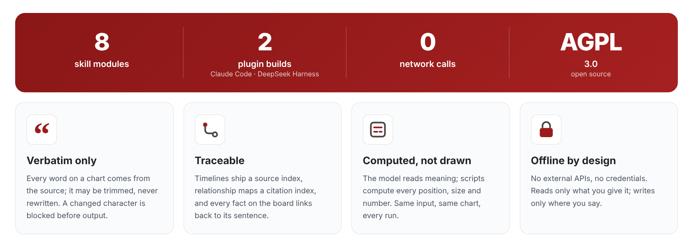
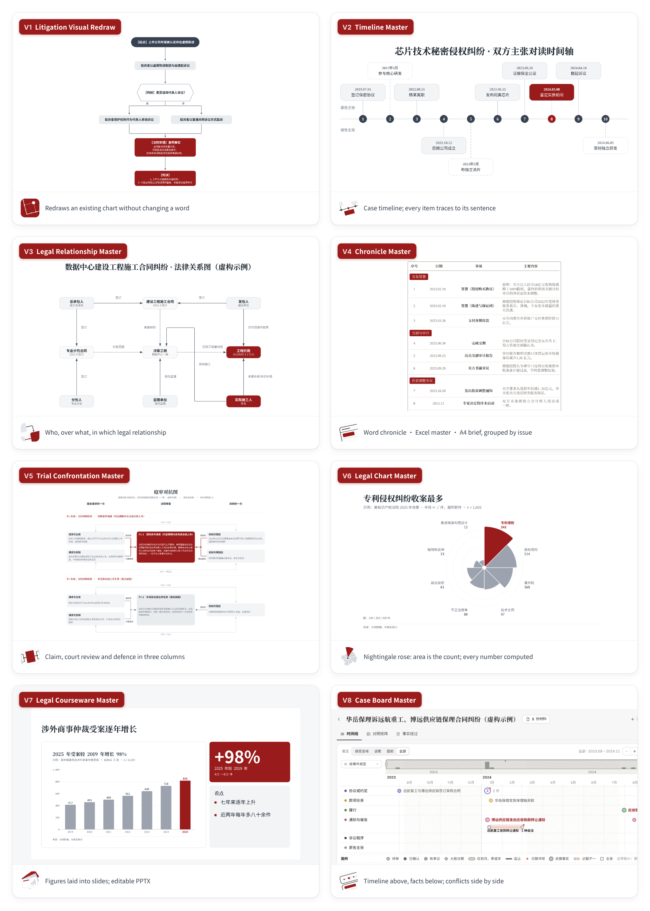
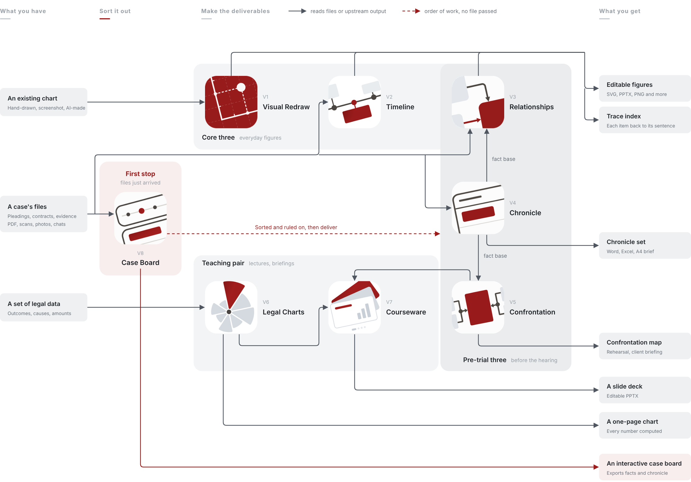
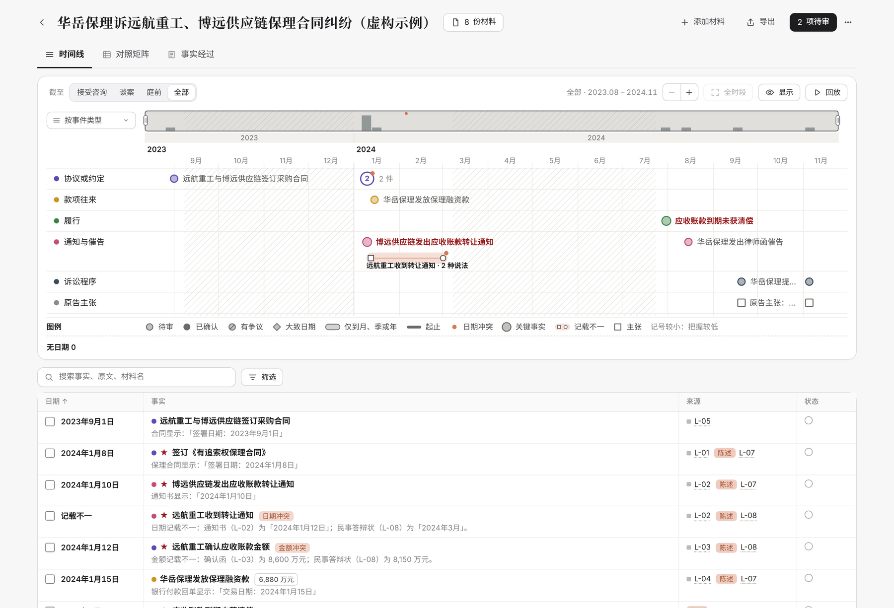

<p align="center">
  
</p>

<p align="center"><a href="README.md">简体中文</a> · <b>English</b></p>

<h3 align="center">Make the Law Visible</h3>

<p align="center">
Litigation visualization skills for lawyers — every word from the source, every figure computed, nothing leaves your computer.
</p>

<p align="center">
  <a href="https://github.com/MiaoQichuan/new-litigation-visualization/releases"></a>
  <a href="LICENSE"></a>
  <a href="https://github.com/MiaoQichuan/new-litigation-visualization/actions/workflows/checks.yml"></a>
  
  
  
  
</p>

<p align="center">
  <a href="#the-eight-modules">Modules</a> ·
  <a href="#quick-start">Quick start</a> ·
  <a href="#how-the-modules-fit-together">How they fit</a> ·
  <a href="#the-case-board">Case board</a> ·
  <a href="#faq">FAQ</a> ·
  <a href="#repository-layout">Repository</a>
</p>

---

**New Litigation Visualization** (新诉讼可视化) is a suite of eight AI skills for litigation lawyers.
Give your AI assistant the case files — judgments, pleadings, contracts, bank records, chat logs — say in one sentence
what you need, and get back a case timeline, a legal-relationship map, a chronicle, a trial confrontation map,
a one-page chart, a slide deck, or an interactive case board where every fact links to its source sentence.
No coding; the scripts run on your own machine.

The skills are written for Chinese litigation practice: they read Chinese court documents and produce figures,
tables and pages in Chinese. The method — the model reads, scripts compute — is language-independent.

<p align="center">
  
</p>

## The eight modules

<p align="center">
  
</p>
<p align="center"><sub>Every tile is real output, not a mock-up, each from a different fictional case; the inputs and script are in <code>assets/src/showcase/</code>.</sub></p>

| | Module | Version | Answers | You give it | You get |
| --- | --- | --- | --- | --- | --- |
|  | **V1** [Litigation Visual Redraw](plugins/mqc-nlv/skills/mqc-litigation-visual-redraw/) | v1.1.0 | How do I make this chart fit for the court file? | An existing chart (hand-drawn, screenshot, AI-made) or a passage of text | SVG · PPTX; PNG · Visio · draw.io optional |
|  | **V2** [Timeline Master](plugins/mqc-nlv/skills/mqc-timeline-master/) | v2.2.0 | What happened, and in what order? | Judgments, pleadings, contracts, bank records, chats (scans and photos too) | Timeline + trace index |
|  | **V3** [Legal Relationship Master](plugins/mqc-nlv/skills/mqc-legal-relation-master/) | v1.0.0 | Who is bound to whom, over what, in which relationship? | A batch of case files | Relationship map + source index |
|  | **V4** [Chronicle Master](plugins/mqc-nlv/skills/mqc-chronicle-master/) | v1.0.0 | When did what happen? | A batch of case files | Word chronicle · Excel master table · A4 brief (groupable by issue) |
|  | **V5** [Trial Confrontation Master](plugins/mqc-nlv/skills/mqc-trial-confrontation-master/) | v1.1.0 | Who claims what, how is it answered, what will the court examine? | Statement of claim, defence, evidence list, submissions | Confrontation map + Excel analysis |
|  | **V6** [Legal Chart Master](plugins/mqc-nlv/skills/mqc-legal-chart-master/) | v0.11.0 | How many, what share, how much was awarded, where did the money go? | A set of legal data (outcomes, causes of action, amounts, flows) | Chart SVG (incl. Nightingale rose) · editable PPTX |
|  | **V7** [Legal Courseware Master](plugins/mqc-nlv/skills/mqc-legal-courseware-master/) | v0.9.1 | How do these figures become a lecture? | Figures from V1–V6, statutes and cases, your firm's template (optional) | Editable PPTX |
|  | **V8** [Case Board Master](plugins/mqc-nlv/skills/mqc-fact-chronology-master/) | v1.0.0 | Putting every party's files together, what happened, and where do the accounts differ? | Every party's materials (pleadings, contracts, IOUs, transfers, chats, transcripts) | An interactive case board (a single offline web page) + its data file |

Each module installs and works on its own; you don't need all eight.

## Quick start

<p align="center">
  
</p>

| You use | How to install |
| --- | --- |
| **Claude Code** | Two commands in the chat, below |
|  **DeepSeek Harness** | Install the plugin package `mqc-nlv-dsh-3.1.0.tgz`; all eight modules at once |
| **Desktop agents** (WorkBuddy, Qwen, Codex, Claude …) | Upload a skill folder on the Skills page |
| **Any other agent that reads `SKILL.md`** | Copy a module folder into its skills directory |

<details open>
<summary><b>Claude Code</b></summary>

```
/plugin marketplace add MiaoQichuan/new-litigation-visualization
/plugin install mqc-nlv@mqc-nlv
```

</details>

<details>
<summary><b>DeepSeek Harness</b> (plugin <code>mqc-nlv-dsh</code>)</summary>

1. Install **Python 3.9 or later** (on Windows, tick "Add python.exe to PATH" on the first page of the installer).
2. Download `mqc-nlv-dsh-3.1.0.tgz` from [Releases](https://github.com/MiaoQichuan/new-litigation-visualization/releases).
3. In DeepSeek Harness, open **Plugins → Add plugin**, enter the full path of the file (without quotes), install and enable it.
4. Quit and reopen DeepSeek Harness, start a new session and ask it to check the New Litigation Visualization environment.

The plugin adds two native tools — `nlv_check` (finds Python, explains what is missing) and `nlv_run` (runs the skill
scripts with arguments passed straight to Python, so Chinese paths work on Windows) — and bundles the Excel and Word
libraries. See [`plugins/mqc-nlv-dsh/README.md`](plugins/mqc-nlv-dsh/README.md) and the [plugin details](plugins/mqc-nlv-dsh/docs/DETAIL.md).

</details>

<details>
<summary><b>Desktop agents and other agents</b></summary>

Every folder under `plugins/mqc-nlv/skills/` is a self-contained skill: upload it on your agent's Skills page, or copy
it into the agent's skills directory. `SKILL.md` is the common format.

</details>

Then hand over the files and say what you need, for example:

```
用时间轴大师，把这份判决书画成案件经过时间轴            Timeline Master: turn this judgment into a case timeline
用案件看板大师，把这个文件夹里的材料做成案件看板          Case Board Master: make a case board from this folder
```

<details>
<summary><b>What do I need installed?</b></summary>

| Capability | Needs | If missing |
| --- | --- | --- |
| SVG and PPTX, the case board | Python 3.9+, no third-party packages | Never missing — this is the default output |
| PNG | Any of Inkscape, rsvg-convert, LibreOffice, resvg-js, Playwright | PNG is skipped with instructions; everything else is produced |
| Layout of flowcharts and relationship maps | graphviz (optional) | A built-in layout computes the coordinates |
| Excel master tables | openpyxl | Reported before the run starts |
| Word chronicle and trace index | Node.js with the `docx` package | Same content written as Markdown |
| Reading scans | poppler's `pdftoppm` | Says so plainly; never skips silently |
| Case board reading PDFs | Any of PyMuPDF, pypdf, pdftotext (PyMuPDF recommended) | Pages it cannot read are flagged for visual reading |

A missing piece removes one format, never the whole run. Environment check:
`python3 plugins/mqc-nlv/skills/mqc-litigation-visual-redraw/scripts/doctor.py`

</details>

## How the modules fit together

<p align="center">
  
</p>

A case moves left to right: the files you have, a first stop to sort them out, the deliverables, and what you get.
A solid line means "reads the files or the upstream output" — a downstream module never changes a byte of what its
upstream wrote. The red dashed line only shows the order of work; no file passes along it.

- **First stop: Case board (V8) · when the files first arrive** — put every party's account into one sequence and rule
  on each conflicting date or amount. Once the facts are settled, go on to timelines, chronicles and confrontation maps.
  The board itself also exports a fact table and a chronicle.
- **Core three (V1–V3) · everyday figures** — redraw an existing chart, draw the timeline, map who is bound to whom and over what.
- **Pre-trial three (V3–V5) · before the hearing** — structure (V3), sequence (V4), issues (V5). V4 writes a fact base
  that V3 and V5 read, so the same event carries the same number on all three.
- **Teaching pair (V6, V7) · lectures and briefings** — V6 draws numbers; V7 draws nothing new, it lays V6's charts and V1–V5's figures into slides.
- Already have a chart to clean up, or only a dataset to plot? Skip the first stop and go straight to V1 or V6.

## The case board

<p align="center">
  
</p>
<p align="center"><sub>V8 Case Board Master · fictional sample case "Huayue Factoring v. Yuanhang Heavy Industries and Boyuan Supply Chain, factoring dispute" (interface in Chinese)</sub></p>

<table>
<tr>
<td width="50%" valign="top"><b>Timeline above, facts below</b><br/><sub>Swimlanes by event type, by document or by party. Click a fact on the timeline and its row in the list lights up; open it to read the original sentence.</sub></td>
<td width="50%" valign="top"><b>Conflicts side by side</b><br/><sub>When documents give different dates or amounts for the same event, the board does not choose. Each conflict goes to a review list for the lawyer to decide, and the decisions are saved with the data.</sub></td>
</tr>
<tr>
<td valign="top"><b>Two more views</b><br/><sub>A comparison matrix — what each document says about each event, one row per event — and a narrative view: a chronicle table and running text, every sentence cited.</sub></td>
<td valign="top"><b>Export what you see</b><br/><sub>Timeline image, fact table, chronicle and narrative, the data file, or print. One web page, no network, opens in any browser.</sub></td>
</tr>
</table>

The board's structure follows the Fact chronology artifact from Anthropic's Legal Artifacts.

## Why the output can be handed in

The hard part of legal AI is not drawing — it is whether the result can go into a court file. Language models draw
easily but fail in three ways: they **change words** (turning "claim dismissed" into "claim upheld"), they are **not
reproducible** (the same files give a different figure next time), and they are **not traceable** (no one can say which
page a line on the figure came from). Litigation tolerates none of the three.

This project splits the work. The model makes only semantic judgments — which sentence states a fact that has already
happened, which sentences describe the same event, who stands in which relationship to whom. Every position, size and
character budget is computed by deterministic scripts, starting from the physical size of an A4 sheet. The same data
always yields the same figure, byte for byte — and when the model misreads something, the mistake is visible in the data.

| Principle | In practice |
| --- | --- |
| **Verbatim** | Every piece of text is taken from the source sentence; shortening is allowed, rewording is stopped |
| **Traceable** | Trace index with timelines, source index with relationship maps, original sentence behind every fact on the case board |
| **Deterministic** | The model outputs data only; all geometry is computed, reproducible and byte-comparable |
| **A4 first** | Layout starts from the paper size: paste into Word and print. The black-and-white style survives photocopy and fax |
| **No conclusions** | Only what the documents already say; where accounts differ they are shown side by side |
| **Guards that can fail** | Every fixed bug becomes a check, and every check is proven to fail when the code is broken on purpose |

## FAQ

<details>
<summary><b>Do I need to code?</b></summary>

No. Give the files to your agent and say what you need. No code, no configuration.

</details>

<details>
<summary><b>Does anything go online? Will my case files leave my computer?</b></summary>

None of the eight modules makes network calls, uses external APIs or needs credentials. They read what you give them and
write only where you say. Where your files go beyond that depends on the agent you use, not on these modules.

</details>

<details>
<summary><b>Will it change the wording of my documents, or draw legal conclusions?</b></summary>

No. Text on a figure is the source sentence with words removed; replacing or adding a word is stopped. It draws only what
the documents say has already happened — a contract clause is an agreement and a claim is an allegation, not an event.

</details>

<details>
<summary><b>What if it gets something wrong?</b></summary>

Timeline Master delivers a trace index (a Word table) listing the document and sentence behind every item; relationship
maps carry a source index; every fact on the case board opens its original sentence. Any error can be checked on the spot.

</details>

<details>
<summary><b>Can the figures go to court? Can I keep editing in PowerPoint?</b></summary>

Yes. A4 printing is the design premise, and the black-and-white style is meant for court filings. In the PPTX every box is
a native shape you can edit.

</details>

<details>
<summary><b>Who decides what is marked in deep red?</b></summary>

You do. Deep red goes on the one or two points that matter most (at most two on a relationship map), and you are asked
before the figure is drawn; you can also say none. If you don't answer, each module follows its own documented rule:
the relationship map marks nothing; Visual Redraw marks its own suggestion and says in the delivery note that it chose it,
and why, so you can remove it; the confrontation map always marks the decisive element.

</details>

<details>
<summary><b>Timeline, Chronicle or Case Board — which one?</b></summary>

Timeline Master produces a figure to hand in; Chronicle Master produces a Word chronicle, an Excel table and an A4 brief;
Case Board Master produces a web page to explore and rule on, best when the files have just arrived and the accounts
have not been sorted out. If you already have a chart and want it redrawn properly, use Litigation Visual Redraw.

</details>

## Repository layout

```
new-litigation-visualization/
├── README.md · README.en.md                 Chinese and English home pages
├── assets/                                  Banner, portrait cover, module icons, output wall, diagrams (src/flow.py draws the diagrams; src/showcase/ holds the wall's fictional case)
├── .claude-plugin/marketplace.json          Plugin marketplace manifest
├── .github/workflows/checks.yml             Regression for all eight modules on every push and PR (UTF-8 and a Chinese-Windows GBK pass)
├── plugins/mqc-nlv-dsh/                     DeepSeek Harness plugin: two native tools, packager and simulated-host tests
└── plugins/mqc-nlv/
    ├── .claude-plugin/plugin.json           Plugin manifest (the suite version is declared here only)
    └── skills/
        ├── mqc-litigation-visual-redraw/    V1 · home of the shared kernel (geometry, fonts, line-breaking, export)
        ├── mqc-timeline-master/             V2 · 69 numbered layout constraints, each with measured values
        ├── mqc-legal-relation-master/       V3 · layout solver, orthogonal routing, routing checks read back from the output
        ├── mqc-chronicle-master/            V4 · ingest, validation, Word / Excel / A4 brief
        ├── mqc-trial-confrontation-master/  V5 · element-by-element reasoning, three-column map
        ├── mqc-legal-chart-master/          V6 · derived numbers, seventeen chart types, guards
        ├── mqc-legal-courseware-master/     V7 · page assembly, figure import, PPTX export and audit, editor
        └── mqc-fact-chronology-master/      V8 · ingest, fact base and checks, the board page (standard library only)
```

Each skill folder contains `SKILL.md` (the instructions the agent follows), `scripts/`, `references/`, `examples/`
and `tests/`. The shared kernel lives in V1 only; other modules import it and may not fork it.

## Engineering

```bash
python3 plugins/mqc-nlv/skills/mqc-litigation-visual-redraw/tests/run_checks.py
python3 plugins/mqc-nlv/skills/mqc-timeline-master/tests/run_checks.py
python3 plugins/mqc-nlv/skills/mqc-legal-relation-master/tests/make_checks.py
python3 plugins/mqc-nlv/skills/mqc-chronicle-master/tests/run_checks.py
python3 plugins/mqc-nlv/skills/mqc-trial-confrontation-master/tests/break_tests.py
python3 plugins/mqc-nlv/skills/mqc-legal-chart-master/tests/run_checks.py
python3 plugins/mqc-nlv/skills/mqc-legal-courseware-master/tests/run_checks.py
python3 plugins/mqc-nlv/skills/mqc-fact-chronology-master/tests/run_checks.py   # add --page for the full page suite
node plugins/mqc-nlv-dsh/tests/dsh_checks.mjs
```

Exit code 0 means everything passed. A few practices that may be useful if you build something similar:

- **Every guard must be able to fail.** After adding a check, break the code on purpose and confirm it fires. The number of checks only goes up.
- **Constraints carry measurements.** Each of the timeline's 69 layout constraints is measured, most with a note of how it once broke.
- **Decision records say what was rejected.** Most ADRs under `docs/adr/` record the alternatives that were turned down.
- **A missing dependency removes one capability**, never the whole run.

## Author

Miao Qichuan (缪奇川), litigation lawyer. Questions, ideas and feedback are welcome via
[Issues](https://github.com/MiaoQichuan/new-litigation-visualization/issues) or miaoqichuan@hotmail.com.

## Contributing

- Report a bug or suggest an idea: open an [Issue](https://github.com/MiaoQichuan/new-litigation-visualization/issues).
  **Never upload real case files** — reproduce with anonymised or fictional samples.
- Code: read [CONTRIBUTING.md](CONTRIBUTING.md) first. Security issues: report privately as described in [SECURITY.md](SECURITY.md).
- Community: [CODE_OF_CONDUCT.md](CODE_OF_CONDUCT.md). Citation: [CITATION.cff](CITATION.cff).

## License

Released under the **GNU Affero General Public License v3.0 only (AGPL-3.0-only)** since v3.0.0; see [LICENSE](LICENSE).
Copyright (C) 2026 Miao Qichuan. Versions up to v2.5.0 were released under MIT and remain available under MIT to those who
obtained them. For use in closed-source products or services, contact the author for a separate licence.

Product names that appear in the text or figures (PowerPoint, Visio, Illustrator, ProcessOn, draw.io, WPS) belong to their
owners and are mentioned only to describe export formats; this project is not affiliated with them.

---

<p align="center"><b>Make the Law Visible</b><br/><sub>New Litigation Visualization · by Miao Qichuan</sub></p>
