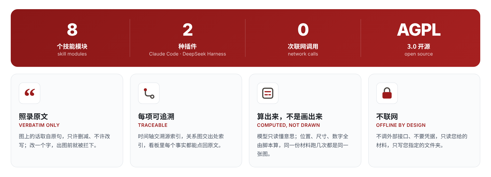
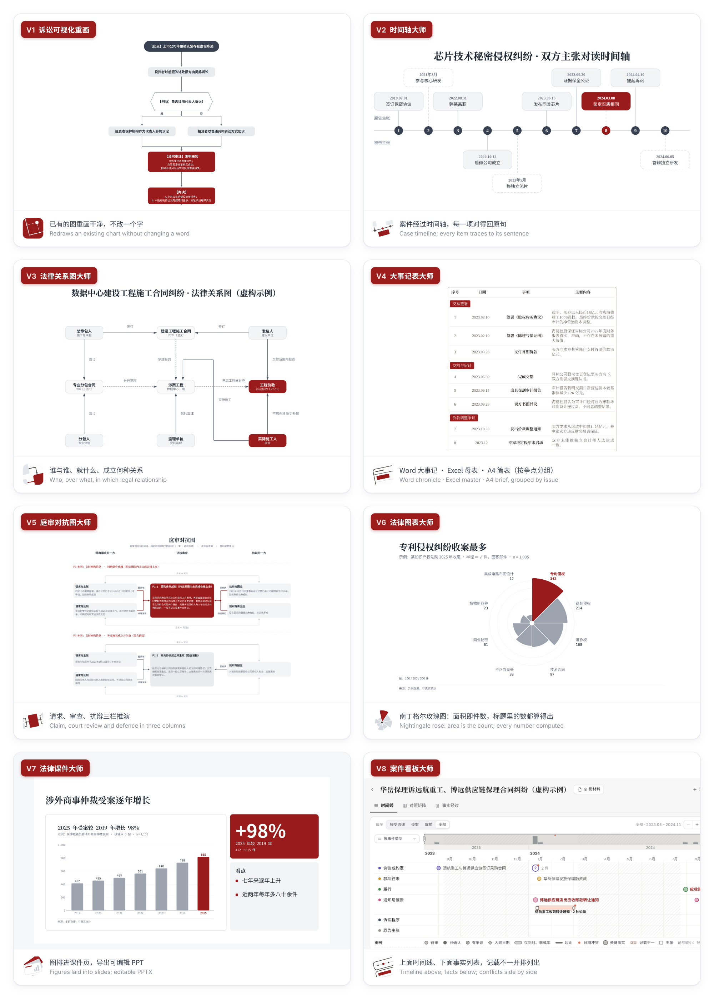
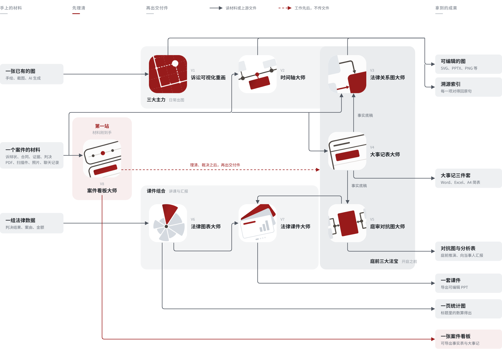
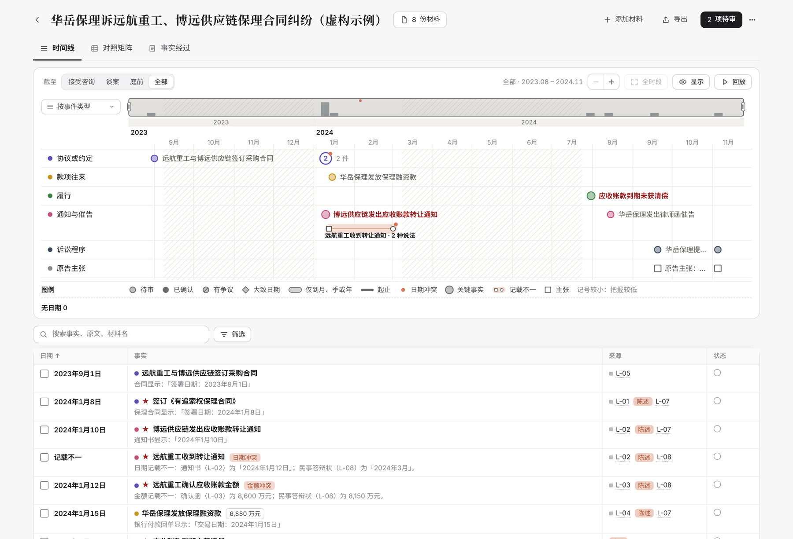

<p align="center">
  
</p>

<p align="center"><b>简体中文</b> · <a href="README.en.md">English</a></p>

<h3 align="center">把法律画出来 · Make the Law Visible</h3>

<p align="center">
给法律人的诉讼可视化工具集：把案件材料变成能直接放进诉讼材料的图、表和看板。<br/>
<sub>Litigation visualization skills for lawyers — every word from the source, every figure computed, nothing leaves your computer.</sub>
</p>

<p align="center">
  <a href="https://github.com/MiaoQichuan/new-litigation-visualization/releases"></a>
  <a href="LICENSE"></a>
  <a href="https://github.com/MiaoQichuan/new-litigation-visualization/actions/workflows/checks.yml"></a>
  
  
  
  
</p>

<p align="center">
  <a href="#八个模块">八个模块</a> ·
  <a href="#三步上手">三步上手</a> ·
  <a href="#怎么配合">怎么配合</a> ·
  <a href="#案件看板">案件看板</a> ·
  <a href="#常见问题">常见问题</a> ·
  <a href="#仓库结构">仓库结构</a>
</p>

---

新诉讼可视化是一套给诉讼律师用的 AI 技能，共八个模块。把判决书、起诉状、合同、转账记录、聊天记录
交给您平时用的 AI 助手，用中文说一句要什么，就能拿到时间轴、法律关系图、大事记、庭审对抗图、统计图、课件，
或者一张每个事实都能点回原文的案件看板。不用写代码，脚本都在您自己的电脑上跑。

<p align="center">
  
</p>

## 八个模块
<sub>The eight modules</sub>

<p align="center">
  
</p>
<p align="center"><sub>每一格都是实际跑出来的成品，不是示意图。八张图各用一件虚构案件，材料与脚本在 <code>assets/src/showcase/</code>。</sub></p>

| | 模块 | 版本 | 回答什么问题 | 交给它什么 | 拿到什么 |
| --- | --- | --- | --- | --- | --- |
|  | **V1** [诉讼可视化重画](plugins/mqc-nlv/skills/mqc-litigation-visual-redraw/) | v1.1.0 | 这张图怎么画得能进卷宗 | 一张已有的图（手绘、截图、AI 生成），或一段文字 | SVG · PPTX；PNG · Visio · drawio 可选 |
|  | **V2** [时间轴大师](plugins/mqc-nlv/skills/mqc-timeline-master/) | v2.2.0 | 案件经过是怎样的 | 判决书、诉辩状、合同、流水、聊天记录（含扫描件、照片） | 时间轴 + 溯源索引 |
|  | **V3** [法律关系图大师](plugins/mqc-nlv/skills/mqc-legal-relation-master/) | v1.0.0 | 谁与谁、就什么标的、成立何种关系 | 一批案件材料 | 关系图 + 出处索引 |
|  | **V4** [大事记表大师](plugins/mqc-nlv/skills/mqc-chronicle-master/) | v1.0.0 | 什么时候发生了什么 | 一批案件材料 | Word 大事记 · Excel 母表 · A4 简表（可按争点分组） |
|  | **V5** [庭审对抗图大师](plugins/mqc-nlv/skills/mqc-trial-confrontation-master/) | v1.1.0 | 谁主张什么、对方怎么抗辩、法院审查什么 | 起诉状、答辩状、证据目录、代理意见 | 对抗图 + Excel 分析表 |
|  | **V6** [法律图表大师](plugins/mqc-nlv/skills/mqc-legal-chart-master/) | v0.11.0 | 有多少、占几成、判了多少、钱流向哪里 | 一组法律数据（判决结果、案由、金额、流水） | 统计图 SVG（含南丁格尔玫瑰图）· 可编辑 PPTX |
|  | **V7** [法律课件大师](plugins/mqc-nlv/skills/mqc-legal-courseware-master/) | v0.9.1 | 这些图怎么做成能上讲台的课件 | V1–V6 的图、法条与案例、律所模板（可选） | 可编辑 PPTX |
|  | **V8** [案件看板大师](plugins/mqc-nlv/skills/mqc-fact-chronology-master/) | v1.0.0 | 各方材料拼起来，事实经过是怎样的、哪里说法不一 | 各方材料（诉辩状、合同、借条、转账记录、聊天记录、笔录） | 一张可交互的案件看板（单个网页，不联网）+ 底稿 |

每个模块都能单独装、单独用，不必八个装齐。

## 三步上手
<sub>Quick start</sub>

<p align="center">
  
</p>

| 您用的是 | 怎么装 |
| --- | --- |
| **Claude Code** | 在对话框里输入两行命令，见下方 |
|  **DeepSeek Harness** | 装插件包 `mqc-nlv-dsh-3.1.0.tgz`，八个模块一次装好 |
| **WorkBuddy、千问、Codex、Claude 等办公智能体** | 在「技能」页上传技能包 |
| **其他读 `SKILL.md` 的 agent** | 把模块文件夹放进它的 skills 目录 |

<details open>
<summary><b>Claude Code</b></summary>

```
/plugin marketplace add MiaoQichuan/new-litigation-visualization
/plugin install mqc-nlv@mqc-nlv
```

</details>

<details>
<summary><b>DeepSeek Harness</b>（插件 <code>mqc-nlv-dsh</code>）</summary>

1. 电脑上先装 **Python 3.9 或更新的版本**（Windows 安装时第一页勾选「Add python.exe to PATH」）；
2. 从本仓库的 [Releases](https://github.com/MiaoQichuan/new-litigation-visualization/releases) 下载 `mqc-nlv-dsh-3.1.0.tgz`；
3. 在 DeepSeek Harness 左侧点 **插件 → 添加插件**，填这个文件的完整路径（例如 `C:\Users\您\Downloads\mqc-nlv-dsh-3.1.0.tgz`，**不要带引号**；安装源保持「中国大陆镜像源」），安装后「立即启用」；
4. 完全退出再打开 DeepSeek Harness，新建会话，说「检查新诉讼可视化的环境」。

插件自带两个工具：`nlv_check` 找本机的 Python、缺什么说清怎么装；`nlv_run` 运行技能脚本，Windows 上中文路径不出错。
出 Excel、写 Word 要用的库都随包附带。以前手动把技能放进 `.dsh/skills` 或 `.agents/skills` 的，请先移走那些同名文件夹。
详见 [`plugins/mqc-nlv-dsh/README.md`](plugins/mqc-nlv-dsh/README.md)。

</details>

<details>
<summary><b>办公智能体</b>（WorkBuddy、千问、Codex、Claude 等）、技能市场与其他 agent</summary>

- 办公智能体：在「技能」页选「上传技能」，把技能包拖进去。仓库 `plugins/mqc-nlv/skills/` 下的每个文件夹就是一个技能包，按需打包上传。
- 技能市场：在 [缪奇川的 SkillHub 主页](https://www.skillhub.cn/user/user_92c667b1) 找到要装的技能，复制安装提示词，发给能执行命令的智能体。
- 其他 agent：把模块文件夹放进它们各自的 skills 目录，`SKILL.md` 是通用格式。

各种装法的演示见 [项目主页](https://www.miaoqichuan.com/nlv.html)。

</details>

装好以后，把材料交给 agent，用中文说一句要什么即可：

```
用时间轴大师，把这份判决书画成案件经过时间轴，交当事人看
用案件看板大师，把这个文件夹里的材料做成案件看板
用法律图表大师，把这 100 份判决的结果构成做成一页图
```

<details>
<summary><b>要装什么？缺了会怎样？</b></summary>

| 能力 | 需要什么 | 缺了会怎样 |
| --- | --- | --- |
| 出 SVG 与 PPTX、生成案件看板 | Python 3.9 或更新的版本，零第三方依赖 | 不会缺，这是默认交付 |
| 出 PNG | Inkscape / rsvg-convert / LibreOffice / resvg-js / Playwright 任一 | 跳过 PNG 并说明怎么补，其余格式照出 |
| 流程图与关系图定位 | graphviz 可选 | 没装时由内置排布算坐标 |
| Excel 母表与分析表 | openpyxl | 开跑前就提示，不会跑到一半崩 |
| 大事记的 Word 版、时间轴的溯源索引 | Node.js 与 docx 包 | 改出同内容的 Markdown，其余照出 |
| 读扫描件 | poppler 的 `pdftoppm` | 明说无法读图，不悄悄跳过 |
| 案件看板读 PDF | PyMuPDF、pypdf、pdftotext 任一（建议 PyMuPDF） | 抽不准的页标「需看图识读」 |

缺一样只少一种格式，没有一项是装不上的。环境自检：
`python3 plugins/mqc-nlv/skills/mqc-litigation-visual-redraw/scripts/doctor.py`

</details>

## 手上有什么，用哪个
<sub>Which one to use</sub>

| 要办的事 | 手上有 | 用 | 拿到 |
| --- | --- | --- | --- |
| **材料刚到手，先理清经过** | 各方材料 | <br/>V8 | 案件看板：时间线、事实列表、记载不一的地方并排列出 |
| **图要交得出去** | 手绘、截图、AI 生成的图 | <br/>V1 | 可编辑的 SVG、PPTX；白描一档可交法院 |
| **画出案件经过** | 判决书、合同、流水、聊天记录 | <br/>V2 | 时间轴，加溯源索引（每一项对得回原句） |
| **理清法律关系** | 判决书、合同、工商登记 | <br/>V3 | 关系图，加出处索引 |
| **整理案件事实** | 整套卷宗 | <br/>V4 | Word 大事记、Excel 母表、A4 简表 |
| **推演庭审攻防** | 诉辩材料与证据 |  <br/>V4 → V5 | 对抗图，加 Excel 分析表 |
| **庭前全面准备** | 整套卷宗 |   <br/>V4 → V3 + V5 | 大事记、关系图、对抗图，同一套编号 |
| **用数据说话** | 判决、案由、金额、流水 | <br/>V6 | 一页统计图，标题里的数都算得出 |
| **做一堂课、向委托人汇报** | 一组数据、画好的图 |  <br/>V6 → V7（V1–V5 的图也能排进来） | 一套课件，导出可编辑 PPT |

## 怎么配合
<sub>How they fit together</sub>

<p align="center">
  
</p>

一件案子从左往右走：手上的材料，先在第一站理清，再出要交出去的图和表，最后是拿到的成果。
实线表示读材料或读上游写好的文件，下游不改上游一个字；红色虚线只表示工作的先后，不传文件。

- **第一站：案件看板（V8）· 材料刚到手**：先把各方材料拼成一条经过，日期、金额说法不一的地方逐条裁决。
  经过理清了，再去出时间轴、大事记、对抗图。看板本身也能导出事实表和大事记。
- **三大主力（V1–V3）· 日常出图**：已有的图重画干净；案件经过画成时间轴；谁与谁、就哪份合同或哪项工程成立什么关系，画成关系图。
- **庭前三大法宝（V3–V5）· 开庭之前**：结构（V3）、时序（V4）、争点（V5）。V4 写出的案件事实底稿供 V3、V5 读取，
  同一件事在三张图上是同一个编号。V3 两组都算。
- **课件组合（V6、V7）· 讲课与汇报**：V6 只画数字；V7 不另画图，把 V6 的图表和 V1–V5 的图排进课件页。
- 手上已经有图、只想重画规范，或只有一组数据要画，不必经过第一站，直接用 V1 或 V6。

## 案件看板
<sub>The case board</sub>

<p align="center">
  
</p>
<p align="center"><sub>V8 案件看板大师 · 虚构示例「华岳保理诉远航重工、博远供应链保理合同纠纷」</sub></p>

<table>
<tr>
<td width="50%" valign="top"><b>上面时间线，下面事实列表</b><br/><sub>按事件类型、材料或当事人分泳道；点图上的事实，下面对应的一行随之标亮，点开能看到原文。</sub></td>
<td width="50%" valign="top"><b>说法不一就并排列出</b><br/><sub>同一件事各份材料写的日期、金额不一样，看板不替您选，标进「待审」由您逐条裁决；裁决随底稿保存，下次打开还在。</sub></td>
</tr>
<tr>
<td valign="top"><b>另有两种看法</b><br/><sub>对照矩阵：同一件事各份材料怎么说，一行看完。事实经过：大事记表与叙述，每句注出处。</sub></td>
<td valign="top"><b>导出看得到的东西</b><br/><sub>时间线图、事实表、大事记表与叙述、底稿，也能直接打印。单个网页，不联网，浏览器打开即用。</sub></td>
</tr>
</table>

## 为什么能放心交出去
<sub>Why it can be handed in</sub>

法律 AI 的难点不在会不会画，而在能不能交。大模型画图容易，问题是三条：**改字**（把「不予支持」写成「予以支持」）、
**不可复现**（同一份材料两次不一样）、**不可追溯**（图上一句话问不出出自哪一页）。诉讼材料对这三条零容忍。

这个项目把作图拆成两段：模型只做语义判断——哪一句是已经发生的事实、哪几句说的是同一件事、谁与谁成立何种关系；
位置、尺寸、每张卡片能写几个字，全部交给确定性脚本，从 A4 纸的物理尺寸一路算下来。模型交出的数据一样，
出来的图就一字不差，可以逐字节比对；模型读错了，也能在数据里一眼看出是哪一条。**画图不是把法律变轻佻，而是把思考变透明。**

| 原则 | 落点 |
| --- | --- |
| **照录原文** | 图上每段文字都取自原句，只许删减、不许改写；改一个词都会在出图前被拦下 |
| **每项可追溯** | 时间轴随图交溯源索引、关系图交出处索引，案件看板里每个事实都能点回原文 |
| **确定性渲染** | 模型只出一份数据，几何全部由脚本算，可复现、可逐字节比对 |
| **A4 是前提** | 版面从纸的尺寸算起，插进 Word 直接能印；白描一档纯黑白，可交法院 |
| **不下结论** | 只画材料里已经写着的事；各方说法不一就并列，不替您择一 |
| **判据先行** | 每个修过的问题都固化成一条检查，且每条检查都要能真的报错 |

## 常见问题
<sub>FAQ</sub>

<details>
<summary><b>我不会写代码，能用吗？</b></summary>

能。把材料交给 agent、用中文说一句要什么。全程不写代码、不改配置。

</details>

<details>
<summary><b>它要联网吗？我的案卷会不会传出去？</b></summary>

八个模块都不联网、不调外部接口、不需要任何凭据，只读您给它的材料，只往您指定的文件夹写文件。
材料本身去了哪里，取决于您用的那个 agent 怎么处理，与这些模块无关。

</details>

<details>
<summary><b>材料要先整理好吗？扫描件、照片能读吗？</b></summary>

不用整理。Word、txt、PDF、截图、照片都行，多份一起给也行。扫描件和手机照片会先探测、再逐页看图，
交付时会写明哪几份出自读图，那几项请您自己复核一遍。

</details>

<details>
<summary><b>它会不会改我材料里的字？会不会自己下法律判断？</b></summary>

都不会。卡片上每一段文字都是原句删减后剩下的样子，换一个词、补一个字都会被拦下。
它只画材料里已经写着的、已经发生的事；合同条款是约定、诉请是主张，都不当作已经发生的事实。

</details>

<details>
<summary><b>万一画错了怎么办？</b></summary>

时间轴大师出图的同时给一份溯源索引（Word 三线表），图上每一项出自哪份材料、哪一句；关系图有出处索引；
案件看板里每个事实都能点开原文。哪一项不对，当场就能对回去。

</details>

<details>
<summary><b>图能直接交法院吗？能在 PPT 里继续改吗？</b></summary>

能。A4 打印是设计前提；要交法院就选白描（纯黑白线稿，复印、传真都不失真）。
PPTX 里每个方框都是原生对象，双击就能改字。

</details>

<details>
<summary><b>时间轴大师、大事记表大师、案件看板大师有什么不同？</b></summary>

时间轴大师出一张可以交出去的图；大事记表大师出 Word、Excel 和 A4 简表；案件看板大师出一张在电脑上看、点、裁决的网页，
适合材料刚到手、各方说法还没理清的时候。手上已经有一张图、只想重画得规范，用诉讼可视化重画。

</details>

<details>
<summary><b>深红标在哪一处，是谁定的？</b></summary>

您定。深红只给最关键的一两处（法律关系图至多两处），出图前会问您标哪里，也可以说不标。
您没回答时，各模块的做法写在各自的说明里：法律关系图大师一处都不标；诉讼可视化重画会先按自己的理解标一处，
在交付说明里写明是它挑的、为什么，方便您改掉；庭审对抗图固定标决定性要件。

</details>

## 仓库结构
<sub>Repository layout</sub>

```
new-litigation-visualization/
├── README.md · README.en.md                 中文与英文首页
├── assets/                                  横幅、竖版封面、模块图标、成品墙、配合图（src/flow.py 出配合图，src/showcase/ 是成品墙的虚构示例）
├── .claude-plugin/marketplace.json          插件市场清单
├── .github/workflows/checks.yml             每次 push 与 PR 跑八个模块的回归（UTF-8 一遍、模拟中文 Windows 的 GBK 一遍）
├── plugins/mqc-nlv-dsh/                     DeepSeek Harness 插件：两个原生工具 + 打包脚本（build.py）与模拟宿主回归
└── plugins/mqc-nlv/
    ├── .claude-plugin/plugin.json           插件清单（插件版本只在这里声明）
    └── skills/
        ├── mqc-litigation-visual-redraw/    V1 · 共享内核所在
        │   ├── SKILL.md                     技能主文档
        │   ├── references/                  规程与标准（含 5 KB 速查页 quick-map.md）
        │   ├── scripts/                     确定性渲染管线
        │   │   ├── render*.py               七种版式 + 纵向形态
        │   │   ├── export_{pptx,vsdx,drawio}.py   可编辑格式导出
        │   │   ├── source_check.py          源图预检（位图先说明代价）
        │   │   ├── layout_fallback.py       没有 graphviz 时的内置分层排布
        │   │   ├── raster_fallback.py       没有转图工具时的 resvg-js / Playwright
        │   │   └── checkpoint.py doctor.py  确认清单与环境自检
        │   └── schemas/ examples/ assets/ tests/
        ├── mqc-timeline-master/             V2
        │   ├── references/                  约束表（69 条编号约束，条条有实测数字）
        │   ├── scripts/                     四轮勾选 → 逐句判定 → 形态与容量 → 出图
        │   │   ├── read_source.py read_doc.py   材料读取（PDF 文字层 / 老式 .doc）
        │   │   ├── render_multiband.py render_vcolumns.py  横向多泳道 / 纵向
        │   │   └── pipeline.py              管线入口，含计时账
        │   └── docs/adr/ schemas/ examples/ assets/ tests/
        ├── mqc-legal-relation-master/       V3
        │   ├── scripts/                     布局求解 · 正交走线 · 走线判据（回读成品验）
        │   ├── assets/                      度序列查表（代码用，模型不必读）
        │   └── references/ examples/ tests/
        ├── mqc-chronicle-master/            V4
        │   ├── scripts/                     摄入 · 校验 · Word/Excel/简表
        │   └── references/ docs/adr/ examples/ tests/
        ├── mqc-trial-confrontation-master/  V5
        │   ├── scripts/                     要件推演 · 三栏出图 · 光栅
        │   └── references/ examples/ tests/
        ├── mqc-legal-chart-master/          V6
        │   ├── scripts/                     校验与派生数 · 十七种图 · 守卫
        │   └── references/ docs/adr/ examples/ schemas/ tests/
        ├── mqc-legal-courseware-master/     V7
        │   ├── scripts/                     拼页 · 图导入 · PPTX 导出与审计 · 编辑器
        │   ├── web/                         磁吸编辑器（单文件）
        │   └── references/ docs/adr/ examples/ tests/
        └── mqc-fact-chronology-master/      V8
            ├── scripts/                     入库 · 拼底稿与检查 · 出页面（只用标准库）
            ├── assets/                      看板页面模板（单文件，不联网）与字体许可
            ├── web/                         页面源码与字体（改页面时重新生成模板用）
            └── references/ docs/adr/ examples/ tests/
```

**共享内核只有一份。** 几何、字体、换行、导出这些多模块共用的代码放在 V1，别的模块引用它、不许各自分叉。
单独分发时（例如法律图表大师的单独安装包）随包带一份拷贝，并记下每个文件的 SHA-256，源头仍只有 V1 这一份。

版式、风格、算法的长篇说明（三类七种布局、三种风格的视觉规范、用数学画准一张时间轴）在各模块自己的说明里：
[诉讼可视化重画](plugins/mqc-nlv/skills/mqc-litigation-visual-redraw/)、[时间轴大师](plugins/mqc-nlv/skills/mqc-timeline-master/)。

## 工程与质量
<sub>Engineering & quality</sub>

```bash
python3 plugins/mqc-nlv/skills/mqc-litigation-visual-redraw/tests/run_checks.py
python3 plugins/mqc-nlv/skills/mqc-timeline-master/tests/run_checks.py
python3 plugins/mqc-nlv/skills/mqc-legal-relation-master/tests/make_checks.py
python3 plugins/mqc-nlv/skills/mqc-chronicle-master/tests/run_checks.py
python3 plugins/mqc-nlv/skills/mqc-trial-confrontation-master/tests/break_tests.py
python3 plugins/mqc-nlv/skills/mqc-legal-chart-master/tests/run_checks.py
python3 plugins/mqc-nlv/skills/mqc-legal-courseware-master/tests/run_checks.py
python3 plugins/mqc-nlv/skills/mqc-fact-chronology-master/tests/run_checks.py   # 加 --page 另跑页面全量回归
node plugins/mqc-nlv-dsh/tests/dsh_checks.mjs
```

退出码 0 = 全过。几条做法，若您也在做类似的东西，或许有参考价值：

- **每条守卫都必须能失败。** 加一条守卫之后要故意把代码改坏，确认它真的报错；检查项只增不减。
  一条靠「请违规者自己举报自己」执行的规则，不算规则。
- **约束表带实测数字与撞坏记录。** 时间轴大师的 [`layout-constraints.md`](plugins/mqc-nlv/skills/mqc-timeline-master/references/layout-constraints.md)
  有 69 条编号约束，每条都是量出来的，多数后面记着当初是怎么撞坏的。
- **决策记录写「否掉了什么」。** 各模块 `docs/adr/` 里的决定记录，多数都写了当时否掉的替代方案。结论有用，排除掉的路一样有用。
- **有反例的检查一条不留。** 宁可少一条检查，也不要留一条会误判的。
- **缺一样只该少一种能力。** 第三方库缺席时退化，不是崩掉。

## 关于作者
<sub>Author</sub>

<p align="center">
  
</p>

想聊法律 AI、诉讼可视化，或者对这个项目有任何建议，欢迎开 Issue，也可以直接发邮件：miaoqichuan@hotmail.com。

## 参与与反馈
<sub>Contributing</sub>

- 报告问题、提建议：开 [Issue](https://github.com/MiaoQichuan/new-litigation-visualization/issues)，按模板填。**请勿上传真实案件材料**，用脱敏或虚构的样例复现。
- 提交代码：先读 [CONTRIBUTING.md](CONTRIBUTING.md)。
- 安全问题：按 [SECURITY.md](SECURITY.md) 私下报告，不要公开开 Issue。
- 社区守则：[CODE_OF_CONDUCT.md](CODE_OF_CONDUCT.md)。
- 引用本项目：见 [CITATION.cff](CITATION.cff)（GitHub 右侧「Cite this repository」）。

## 许可
<sub>License</sub>

自 v3.0.0 起以 **GNU Affero 通用公共许可证第 3 版（AGPL-3.0-only）** 发布，全文见 [LICENSE](LICENSE)。
Copyright (C) 2026 缪奇川（Miao Qichuan）。作者 [缪奇川](https://github.com/MiaoQichuan)，公众号：奇川律师。

简单说：可以自由使用、学习、修改和再分发；但凡分发修改后的版本，或把它改造后通过网络向他人提供服务，
都必须以同一许可公开相应的完整源代码，并保留原作者的版权与许可声明。

v2.5.0 及以前的版本以 MIT 许可发布，已经按 MIT 取得那些版本的人，仍可按 MIT 使用那些版本；
此后的新版本与新代码只适用 AGPL-3.0。需要在闭源产品或不公开源码的服务中使用的，请联系作者另行授权。

案件看板大师的页面结构参照 Anthropic Legal Artifacts 的 Fact chronology。文中与示意图里出现的 PowerPoint、Visio、
Illustrator、ProcessOn、draw.io、WPS 等产品名称与图标，归各自的权利人所有，只用来说明能导出哪些格式；
它们不在本项目许可的范围内，本项目与这些公司也没有关联。

---

<p align="center"><b>把法律画出来 · Make the Law Visible</b><br/><sub>新诉讼可视化 New Litigation Visualization ｜ 缪奇川 出品</sub></p>
