<p align="center">
  
</p>

<p align="center">
  <a href="LICENSE"></a>
  
  <a href="https://github.com/MiaoQichuan/new-litigation-visualization/actions/workflows/checks.yml"></a>
  
  
  
  
  
  
</p>

<p align="center"><b>把法律画出来</b> · Make the Law Visible<br/>给法律人的诉讼可视化工具集：把案件材料变成能直接放进诉讼材料的图和表。</p>

---

**Litigation visualization, made deterministic.** Seven installable skills that turn case
files and legal data into court-ready figures, charts and tables. The model only reads meaning; every coordinate,
size and character budget is computed by deterministic scripts from the physical size of an
A4 sheet. Text on a figure is always a subsequence of the source sentence, and every element
traces back to the document and sentence it came from. MIT licensed, no network calls, works
with any agent that reads `SKILL.md`.

## 为什么做这件事

**诉讼可视化的价值，法官与当事人都验证过。** 一页时间轴省下的是庭审上十分钟的口头梳理；
一张法律关系图让当事人第一次看懂自己案子的结构；一份大事记表让合议庭不必在几百页卷宗里
反复翻找。这些不是美工问题，是沟通效率问题。

**法律 AI 的难点不在会不会画，而在能不能交。** 大模型画图容易，问题是三条：改字（把
「不予支持」写成「予以支持」）、不可复现（同一份材料两次不一样）、不可追溯（图上一句话
问不出它出自哪一页）。法庭材料对这三条零容忍。

**这个项目的做法是把作图拆成两段。** 模型只做语义判断：哪一句是已经发生的事实、哪几句
属于同一件事、谁与谁成立何种关系。位置、尺寸、层数、每张卡片能写几个字，全部交给确定性
脚本，从 A4 纸的物理尺寸一路算到像素。难的那部分不在模型手里，所以同一份材料换谁跑、
跑几次，出来都是同一张图，换一个更弱的模型也一样。**画图不是把法律变轻佻，而是把思考
变透明。**

## 四条设计原则

| 原则 | 落点 |
| --- | --- |
| **确定性渲染** | 模型只出一份 JSON，几何全部由脚本算。布局可复现、可缓存、可逐字节比对 |
| **照录原文** | 图上每段文字必须是原句的子序列，只许删减、不许改写；改一个词都会在出图前被拦下 |
| **A4 是前提** | 版面从纸的物理尺寸算起，不是导出选项。插进 Word 直接能印，白描一档可交法院 |
| **判据先行** | 每条已修复的问题固化成守卫，且每条守卫都必须能失败：加守卫要先把代码改坏，确认它真报错 |

## 七个模块

| | 模块 | 版本 | 回答什么问题 | 输入 | 交付物 |
| --- | --- | --- | --- | --- | --- |
|  | **V1** [诉讼可视化重画](plugins/mqc-nlv/skills/mqc-litigation-visual-redraw/) | v1.1.0 | 这张图怎么画得能进卷宗 | 一张已有的图（手绘、截图、AI 生成、Mermaid），或一段纯文字 | SVG · PPTX（默认）；PNG · VSDX · drawio 可选 |
|  | **V2** [时间轴大师](plugins/mqc-nlv/skills/mqc-timeline-master/) | v2.2.0 | 案件经过是怎样的 | 判决书 · 起诉状 · 答辩状 · 合同 · 证据目录 · 流水 · 聊天记录（PDF、老式 .doc、扫描件、照片、口述） | 同上 + 溯源索引 |
|  | **V3** [法律关系图大师](plugins/mqc-nlv/skills/mqc-legal-relation-master/) | v1.0.0 | 谁与谁、就什么标的、成立何种关系 | 一批案件材料 | 同上 + 出处索引 |
|  | **V4** [大事记表大师](plugins/mqc-nlv/skills/mqc-chronicle-master/) | v1.0.0 | 什么时候发生了什么 | 一批案件材料 | 案件大事记 Word · Excel 母表 · A4 简表（默认）；简表 PDF/PNG 可选 |
|  | **V5** [庭审对抗图大师](plugins/mqc-nlv/skills/mqc-trial-confrontation-master/) | v1.0.0 | 谁主张什么、对方怎么抗辩、法院审查什么 | 起诉状 · 答辩状 · 证据目录 · 代理意见 | 分析表 Excel · 对抗图 SVG（默认）；PNG 可选 |
|  | **V6** [法律图表大师](plugins/mqc-nlv/skills/mqc-legal-chart-master/) | v0.11.0 | 有多少、占几成、判了多少、钱流向哪里 | 一组法律数据（判决结果、案由、金额、天数、去向、资金流水） | SVG · PPTX（默认）；PNG 可选 |
|  | **V7** [法律课件大师](plugins/mqc-nlv/skills/mqc-legal-courseware-master/) | v0.9.0 | 这些图怎么做成一页能上讲台的法律图表页，粘进自己的课件 | V1–V6 的图、法条与案例、一句想法、律所模板或截图（可选） | 可编辑 PPTX（整页或框选复制；图里每个元素各成一组，按读图编号自带讲课动画） |

**三组用法，V3 是交叠处。**

- **三大主力（V1 到 V3）· 日常出图**：把手上已有的图重画干净、把案件经过画成时间轴、
  把当事人与标的之间的关系画成一张网。
- **庭前三大法宝（V3 到 V5）· 开庭之前**：回答开庭前必须回答的三个问题：结构（V3）、时序（V4）、
  争点（V5）。V4 出的案件事实底稿是另两件的上游，三者读同一份底稿，同一件事在三张图上
  指向同一个编号。V3 同属两组，既是日常出图的主力，也是庭前准备的一件。
- **课件组合（V6、V7）· 讲课与汇报**：V6 只画数字（有多少、占几成、判了多少），主要去处是课件、
  讲座与汇报；V7 不画新图，把 V6 的图表与 V1–V5 的图排成课件，只读它们，不改它们一个字节。

### 各模块在做什么

**V1 诉讼可视化重画。** 先做源图预检：矢量原件与有文字层的 PDF 直接放行，位图与扫描件
会先说明代价再问你是否继续（读图慢、贵、易读错）。七种版式按判据自动落档，事件多到横向
排不下时自动改用 A4 竖版。三种风格：奇川风（当事人）、歸藏风（讲课与公众号）、白描（法院）。

**V2 时间轴大师。** 直接读材料：有文字层的 PDF、老式 .doc 一条命令读入，扫描件走读图三步。
逐句判定哪些是已经发生的事实，按四轮勾选收窄范围，再由代码算形态与每张卡的字数容量。
出图同时写溯源索引，图上每一项对得回材料的哪一句。

**V3 法律关系图大师。** 主体与客体并存的关系网，走线全部正交、判据 15 条（穿节点、共线
重叠、圆角方向、文字越出画布、图名被压、文字互相压……），不合格的布局在候选阶段就被换掉。

**V4 大事记表大师。** 一次出三件：Word 交付版（宋体加新罗马、页边距与列宽按规范定死）、
Excel 母表（律师在里面填争点）、A4 简表（呈报用）。事实行走封闭动词表，不合规的写法出表前
被拦。它同时生成案件事实底稿，供 V3 与 V5 复用。

**V5 庭审对抗图大师。** 按要件审判九步法与请求权基础，把案件推成左中右三栏：提出请求的
一方、法院审查、抗辩的一方，深红标出决定性要件。图与表同源，一致性由判据核验。

**V6 法律图表大师。** 十七种精炼的统计图：竖柱、横条、百点方阵、南丁格尔玫瑰、哑铃、逐件分布、
桑基、汇入图（资金流向）、逐级加减，以及 0.10.0 新增的气泡矩阵（年鉴）、发射扇、放射汇聚（另有漏斗作备用），0.11.0 新增的点阵阶梯、法条沿革、区间胶囊、双读饼，图种由数据形状决定。背后是一个按领域、场景、意图、画法索引的
场景库（34 个领域、430 个场景、68 种画法；现在能画的场景 226 个，其余标「待建」），用时按关键词检索，只取用得上的几条。
前五件厚重严谨，这一件广泛灵动：旅程、倒计时、冰山、拼图、金句卡……灵动在表达，严谨在数据。
丢一批判决给它，走类案编码：逐份编码、类别取封闭表、每个值附原文引句，一次出编码母表和一组图。图上的数只许算、不许编：标题里写的百分比与件数，脚本都会从数据里
算一遍；没有 n、口径与来源的图不出。

**V7 法律课件大师。** 法律垂类的磁吸课件编辑器。一页 12 栏 × 6 行的网格，法条、裁判要旨、案例、争议焦点、风险提示、
证据、要点、大数字、金句等卡片，和 V1–V6 的图（案情时间轴、法律关系图、争点对抗图、大事记简表、类案数据图），拖进页面就吸到
格子上，同类卡片自动连成一组（学自 M3E Canvas 的磁吸连接）。律所名片录一次，一键生成律所介绍页、律师简介页、结束页，
每页页脚可放 Logo。用户点「AI 生成」写一句想法，由对话里的 AI 生成封面、整页、单张卡片，或调用 V1–V6 出图；用户拖一拖、
改一改，导出每个元素都能改的 PPTX（只有 Logo 是图片）。上传律所自己的 PPT 模板，系统读懂它的主色、字体、Logo，生成律所风格，图表也跟着换成律所主色。法条与要旨照录原文、案号不编、大数字要能由图表推出；导出后回读审计。

## 怎么配合

从手上的材料、要办的事出发：左边是手上有什么，中间用哪几个模块，右边拿到什么。

<p align="center">
  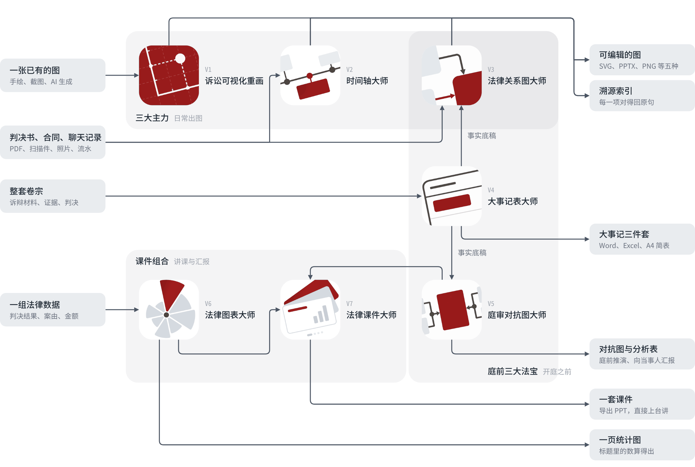
</p>

| 要办的事 | 手上有 | 用 | 拿到 |
| --- | --- | --- | --- |
| **图要交得出去** | 手绘、截图、AI 生成的图 | <br/>V1 | 可编辑的 SVG、PPTX；白描一档可交法院 |
| **理清案件经过** | 判决书、合同、流水、聊天记录 | <br/>V2 | 时间轴，加溯源索引（每一项对得回原句） |
| **理清法律关系** | 判决书、合同、工商登记 | <br/>V3 | 关系图，加出处索引 |
| **整理案件事实** | 整套卷宗 | <br/>V4 | Word 交付版、Excel 母表、A4 简表 |
| **推演庭审攻防** | 诉辩材料与证据 |  <br/>V4 → V5 | 对抗图，加 Excel 分析表 |
| **庭前全面准备** | 整套卷宗 |   <br/>V4 → V3 + V5 | 大事记、关系图、对抗图，同一套编号 |
| **用数据说话** | 判决、案由、金额、流水 | <br/>V6 | 一页统计图，标题里的数都算得出 |
| **做一堂课** | 一组数据，加画好的图 |  <br/>V6 → V7（V1–V5 的图也排进来） | 一套课件，导出可编辑 PPT |
| **向委托人汇报** | 一个案件的卷宗 |  <br/>V4 → V3 + V5 → V7 | 一套汇报 PPT |

箭头只表示读谁的产物：下游模块读上游写好的文件（事实底稿、图、出处记录），不改上游一个字节。
每个模块也都能单独用，不必按顺序装齐。

**装在哪都行。** 七个模块都是标准的 `SKILL.md` 目录，没有产品特定的胶水代码：Claude Code、
Codex、DeepSeek Harness、Cursor、Gemini CLI、Copilot、Cline、Aider 都装得上。同一份仓库，
不维护两套。

## 快速开始

Claude Code：

```
/plugin marketplace add MiaoQichuan/new-litigation-visualization
/plugin install mqc-nlv@mqc-nlv
```

装完跑一次环境自检，它逐项告诉你缺什么、缺了会退化成什么样（没有一项是装不上，
都是少一种格式）：

```bash
python3 plugins/mqc-nlv/skills/mqc-litigation-visual-redraw/scripts/doctor.py
```

然后把材料丢给 agent，用中文说一句要什么即可，例如：

```
用时间轴大师，把这份判决书画成案件经过时间轴，交当事人看
```

**DeepSeek Harness**：挂目录即可，不必构建（它的技能发现是扁平的，指到 `skills/`
这一层，会扫到下面每一个 `<模块名>/SKILL.md`）：

```yaml
skills:
  local:
    customSkillDirs:
      - "./new-litigation-visualization/plugins/mqc-nlv/skills"
```

dsh 的发现优先级（先命中先生效）：项目 `.dsh` → 项目 `.agents` → `customSkillDirs` →
用户 `.dsh` → 用户 `.agents`。它把 `allowed-tools` / `disallowed-tools` 当未知字段处理，
技能内的工具约束需要在 harness 层自行保证。

**桌面办公智能体**（WorkBuddy、千问、Codex、Claude 等）：在「技能」页选「上传技能」，
把技能包拖进去。仓库 `plugins/mqc-nlv/skills/` 下的每个文件夹就是一个技能包，按需打包上传。

**技能市场**：在 [缪奇川的 SkillHub 主页](https://www.skillhub.cn/user/user_92c667b1) 找到要装的技能，
复制技能页上的安装提示词，发给能执行命令的智能体。

**其他 agent**：把模块目录放进它们各自的 skills 目录，`SKILL.md` 是通用格式。

各种装法的演示见 [项目主页](https://www.miaoqichuan.com/nlv.html)。

### 环境与依赖

| 能力 | 需要什么 | 缺了会怎样 |
| --- | --- | --- |
| 出 SVG 与 PPTX | Python 3，零第三方依赖 | 不会缺 —— 这也是默认交付的两种 |
| 出 PNG | Inkscape / rsvg-convert / LibreOffice / resvg-js / Playwright 任一 | 跳过 PNG 并说明怎么补，其余格式照出 |
| 流程图与关系图定位 | graphviz 可选 | 没装时由内置分层排布算坐标，实测画布相差 2 像素 |
| Excel 母表与分析表 | openpyxl | 出表那一步开跑前就提示，不会跑到一半崩 |
| 大事记的 Word 交付版 | node 与 docx 包 | 改出同内容的 Markdown，Excel 与简表照出 |
| 读扫描件 | poppler 的 `pdftoppm` | 明说无法读图，不静默跳过 |

## 仓库结构

```
new-litigation-visualization/
├── assets/                                  仓库封面、模块图标与配合图
├── .claude-plugin/marketplace.json          插件市场清单
├── .github/workflows/checks.yml             每次 push 与 PR 跑七个模块的回归
└── plugins/mqc-nlv/
    ├── .claude-plugin/plugin.json           插件清单（插件版本只在这里声明）
    └── skills/
        ├── mqc-litigation-visual-redraw/    V1 · 共享内核所在
        │   ├── SKILL.md                     技能主文档
        │   ├── references/                  规程与标准（含 5 KB 速查页 quick-map.md）
        │   ├── scripts/                     确定性渲染管线
        │   │   ├── render*.py               七种版式 + 纵向形态
        │   │   ├── export_{pptx,vsdx,drawio}.py   可编辑格式导出
        │   │   ├── source_check.py          源图预检（位图先说明代价）
        │   │   ├── layout_fallback.py       没有 graphviz 时的内置分层排布
        │   │   ├── raster_fallback.py       没有转图工具时的 resvg-js / Playwright
        │   │   └── checkpoint.py doctor.py  确认清单与环境自检
        │   └── schemas/ examples/ assets/ tests/
        ├── mqc-timeline-master/             V2
        │   ├── references/                  约束表（69 条编号约束，条条有实测数字）
        │   ├── scripts/                     四轮勾选 → 逐句判定 → 形态与容量 → 出图
        │   │   ├── read_source.py read_doc.py   材料读取（PDF 文字层 / 老式 .doc）
        │   │   ├── render_multiband.py render_vcolumns.py  横向多泳道 / 纵向
        │   │   └── pipeline.py              管线入口，含计时账
        │   └── docs/adr/ schemas/ examples/ assets/ tests/
        ├── mqc-legal-relation-master/       V3
        │   ├── scripts/                     布局求解 · 正交走线 · 15 条路线判据
        │   ├── assets/                      度序列查表（代码用，模型不必读）
        │   └── vendor/v1/                   单独分发时随包带的共享内核
        ├── mqc-chronicle-master/            V4
        │   ├── scripts/                     摄入 · 校验 · Word/Excel/简表
        │   └── references/ docs/adr/ examples/ tests/
        ├── mqc-trial-confrontation-master/  V5
        │   ├── scripts/                     要件推演 · 三栏出图 · 光栅
        │   └── references/ examples/ tests/
        ├── mqc-legal-chart-master/          V6
        │   ├── scripts/                     校验与派生数 · 十七种图 · 守卫
        │   └── references/ docs/adr/ examples/ schemas/ tests/
        └── mqc-legal-courseware-master/     V7
            ├── scripts/                     拼页 · 图导入 · PPTX 导出与审计 · 编辑器
            ├── web/                         磁吸编辑器（单文件）
            └── references/ docs/adr/ examples/ tests/
```

**共享内核只有一份。** 几何、字体、换行、导出这些多模块共用的代码放在 V1，别的模块引用
它、不许各自分叉。单独分发时按各自约定随包带一份，并由守卫逐字节比对，防止两边走偏。

## 两个模块的细节

### V1 诉讼可视化重画

把一张凌乱、或者一眼「AI 味」的诉讼图，重画成克制、专业、可直接进诉讼材料的图，
源文件一并交给你，回头还能接着改。**律师只做两件事：上传原图，说一句提示词。**

<p align="center">
  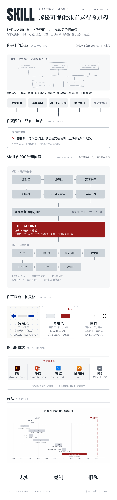
</p>

### 三类七种布局

时间、流程、关系。诉讼里要画的东西基本都落在这三类里，**图种不由你选，由材料的性质决定**。

<p align="center">
  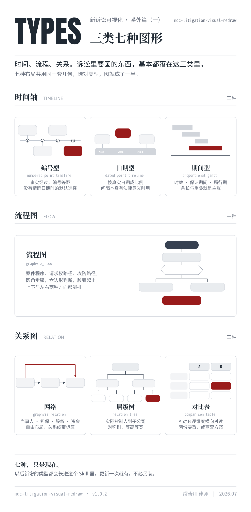
</p>

### 七种布局 × 三种风格

同一份语义地图，换一个风格标志就换一套表达，几何一个数都不动。

|  |  |
| :--: | :--: |
| 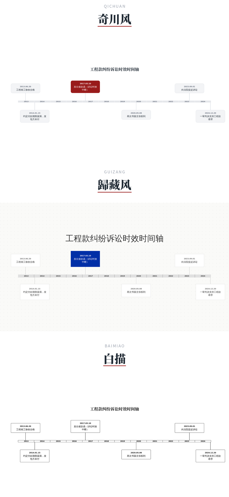<br/><sub>日期型时间轴</sub> | 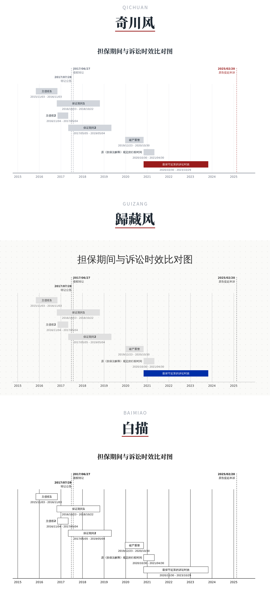<br/><sub>期间型时间轴</sub> |
| 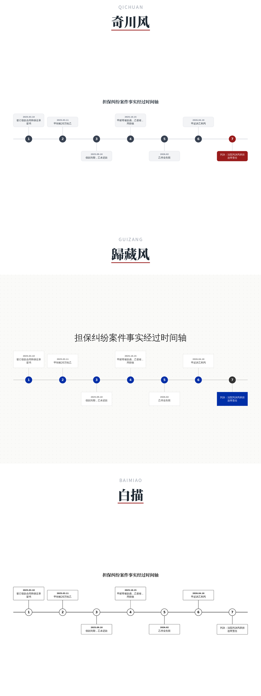<br/><sub>编号型时间轴</sub> | 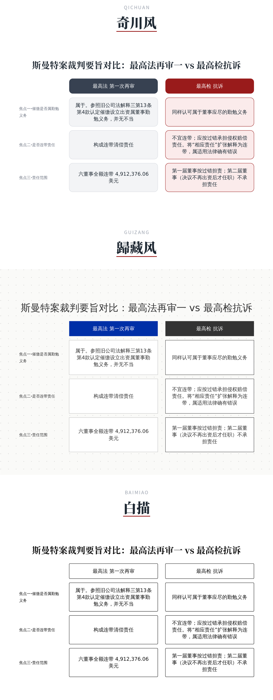<br/><sub>A/B 对比表</sub> |
| 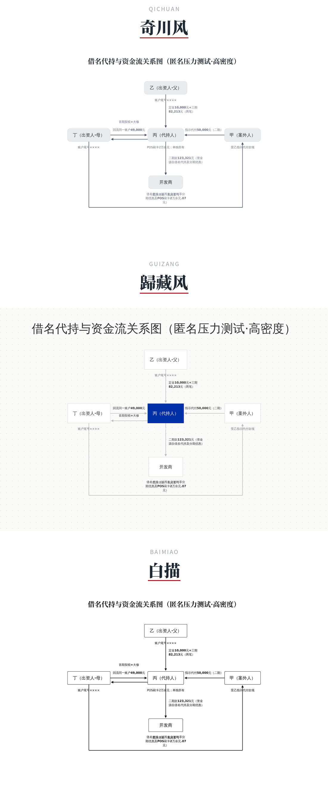<br/><sub>关系网络（密集）</sub> | 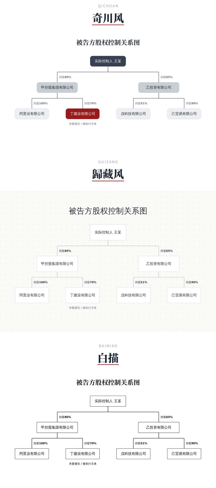<br/><sub>层级树</sub> |
| 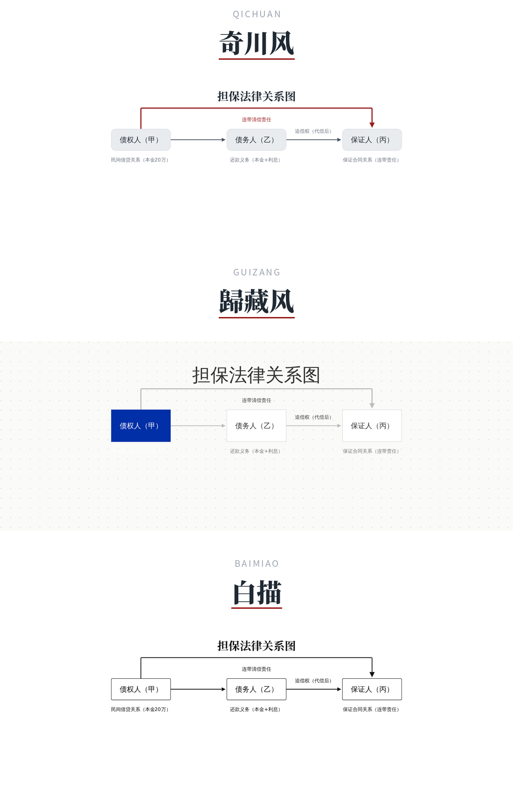<br/><sub>关系网络</sub> |  |
| 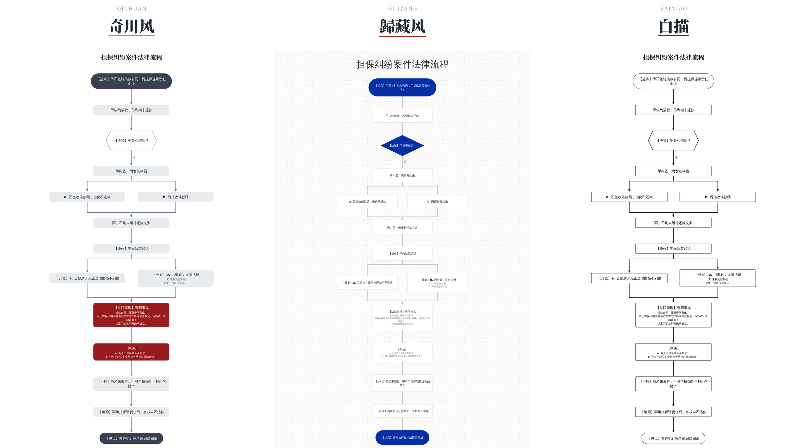<br/><sub>流程图</sub> | 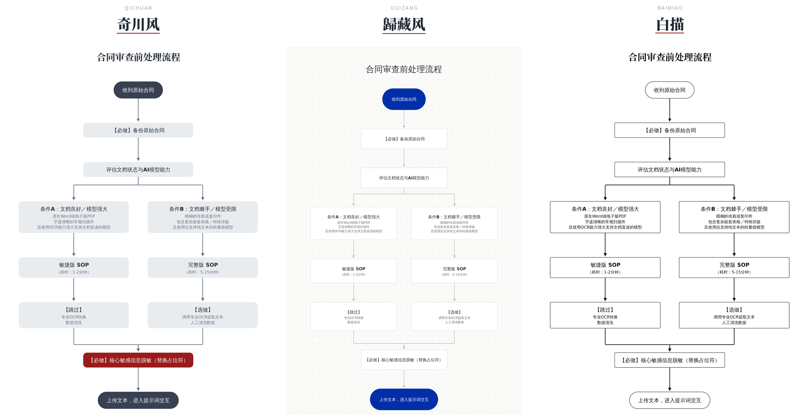<br/><sub>流程图（合同审查）</sub> |

<details>
<summary><b>三种视觉风格 · 点开看完整对照</b>（奇川风 · 白描 · 歸藏风）</summary>

<br/>

三种风格共用同一套几何：圆角多大、连线多粗、卡片怎么错开、字号怎么分层，全都
一模一样，变的只是表达。所以换风格不会改变图的结构，也不会让某一版排得更松或
更挤。下面三张长图分别是三套完整的视觉规范，每一个数值都写在上面。

**奇川风** — 灰阶为底，一处深红标重点，向委托人与法官呈现。

<p align="center">
  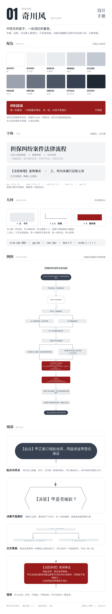
</p>

**白描** — 纯黑白线稿，专为打印与卷宗，复印、传真都不失真。

<p align="center">
  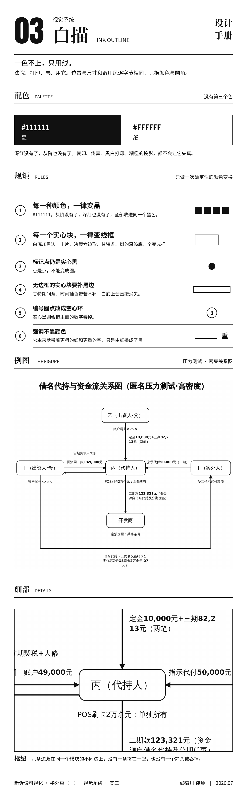
</p>

**歸藏风** — 克莱因蓝，用于对外传播、讲课与分享。

<p align="center">
  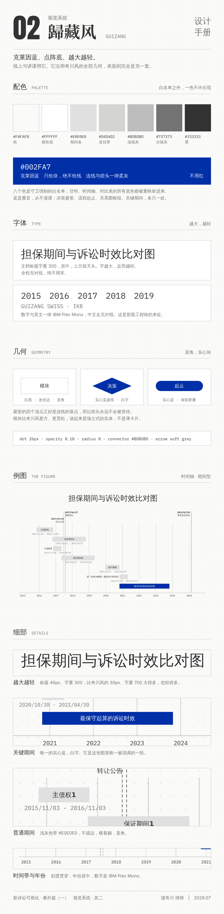
</p>

</details>

模块完整说明见 [它自己的 README](plugins/mqc-nlv/skills/mqc-litigation-visual-redraw/)。

### V2 时间轴大师

不用你先画。把判决书、起诉状、答辩状、合同、证据目录、流水、聊天记录、扫描件、
手机照片、甚至一段口述丢给它，它读完最多问你五个问题，然后出图。

**时间轴大师，用数学，画准一张时间轴。**

<p align="center">
  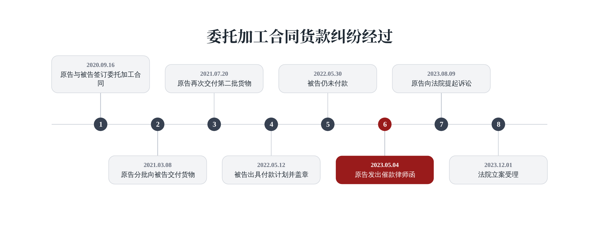
</p>
<p align="center"><sub>真实输出：八个事项、深红标在你指定的那一处、A4 横版直接打印</sub></p>

### 用数学算清楚一张时间轴怎么画

一张 A4 有多宽是定死的。时间轴上有几个时点，轴就被分成几段，每一段的长度决定了
模块落在哪里；位置定住才知道相邻两块之间还剩多少空，剩多少空决定一块能有多宽，
宽度定了才知道这一块能写几个字。**先定位置，再定尺寸，最后才定能写多少字。**
下面这张长图把这条链路和两道几何门禁逐步拆开讲了一遍。

<p align="center">
  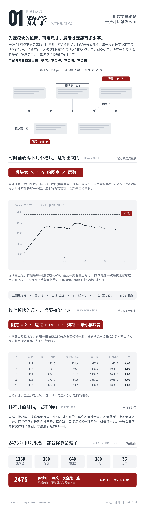
</p>

<details>
<summary><b>02 画准 · 前端负责读懂，后端负责算准</b>（点开看长图）</summary>

<br/>

一张图画不准，无非两件事出错：该画的事没抽对，或者抽对了却排不下。所以这里分成
两段各管一件，中间只交接一个数。前端从材料里把有法律含义的事实抽出来，交出一份
事项清单；后端按这一档的几何算出每一块能写多少字，把这个数交回去；前端再按这个
数把字写到位。**反过来先写好再排，就只剩两条路：把字截掉，或者把版面挤坏。**

这张长图还讲了忠实性怎么验：卡片上每一段文字都必须是原句删掉一些字之后剩下的
样子，换一个词、调一次词序、补一个字，都会在出图之前被拦住。

<p align="center">
  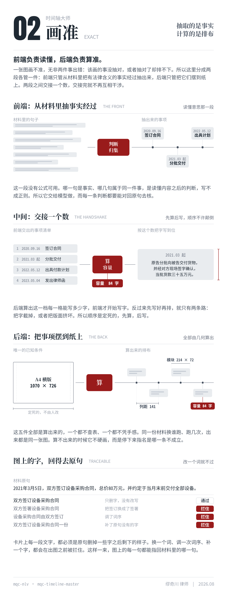
</p>

</details>

<details>
<summary><b>03 使用手册 · 材料怎么给、它问什么、你拿到什么</b>（点开看长图）</summary>

<br/>

材料怎么顺手怎么给，不用先整理、不用改格式、不用自己先画一张。它读完最多问你五个
问题，该问的才问：只有一份材料就不问第一问，日期不足八个就不问第二问，风格不是
奇川风就不问标红。问完就出图，之后不再打断你。

这张长图逐一列出了它吃哪些材料、三种形态各自用在什么场合、泳道怎么分、五种交付
格式分别用什么软件打开，以及那份 Word 溯源索引长什么样。

<p align="center">
  
</p>

</details>

模块完整说明见 [它自己的 README](plugins/mqc-nlv/skills/mqc-timeline-master/)。

## 常见问题

### 装与跑

**我不会写代码，能用吗？**
能。你只需要把材料丢给 agent、用中文说一句要什么。全程不写代码、不改配置、
不学任何语法。

**它要联网吗？我的案卷会不会传出去？**
七个模块都不联网、不调外部接口、不需要任何凭据，只读你给它的材料，只往你指定的
目录写文件。你的材料本身去了哪里，取决于你用的那个 agent 怎么处理，
与这些模块无关。

**要装什么？会不会很麻烦？**
重画与时间轴大师：Python 3（零第三方依赖，**graphviz 也不再必需** —— 没装时由内置
分层排布算坐标，实测画布与装了的版本相差 2 像素）。庭前三大法宝另需少量第三方库（如
openpyxl、cairosvg，大事记表出 Word 还需 node），各自的 SKILL.md 列明；法律关系图大师可以先跑
`python scripts/make.py --check` 查环境。出 PNG 需要 LibreOffice 或 poppler，读扫描件需要
poppler 的 `pdftoppm`，溯源索引需要 node。跑一次 `doctor.py` 它会逐项告诉你缺
什么、缺了会退化成什么样。没有一项是装不上，都是少一种格式。

### 材料怎么给

**材料要先整理好吗？**
不用。怎么顺手怎么给：Word、txt、Markdown、PDF、截图、照片都行，多份一起给也行。
不用改格式、不用先摘出时间点、不用自己先画一张。

**扫描件和手机拍的照片能读吗？**
能。没有文字层的材料它会先探测、再按 150 DPI 栅格化、然后逐页看图。交付时会明写
哪几份出自读图。那几项没有文字层可以逐字比对，请你自己复核一遍。

**一堆材料一起给，它会不会读混？**
它会先问你这张图用哪几份材料。而且每一个事项都记着出自哪一份、哪一句，
溯源索引里逐项列出来。

### 出来的图

**图能直接交法院吗？**
A4 打印是设计前提，不是导出选项。排布的每一个数都从纸的物理尺寸算起，所以插进
Word 直接能印。要交法院就选白描：纯黑白线稿，复印、传真、黑白打印都不失真。

**能在 PPT 里继续改吗？**
能。可选的五种格式：SVG（主交付物）、PNG（位图）、PPTX（原生对象，每个方框双击
就能改字）、VSDX（ProcessOn / Visio / WPS）、drawio，五份都转写自同一份母版。
**格式由你选**（确认那一步顺带问，可多选）；不选就只出 SVG 与 PPTX —— 这两种在任何
一台 Windows 上都出得来，而 PNG 要本机有转图工具，选了才出。要全套就答「全部」。

**它会不会改我材料里的字？**
不会，这是铁律。卡片上每一段文字必须是原句删掉一些字之后剩下的样子：换一个词、
调一次词序、补一个字，都会在出图之前被拦住。

**万一它画错了怎么办？**
出图的同时会给一份 Word 三线表：图上每一个元素，出自材料的哪一份、哪一句。打印
出来夹在卷宗里，逐项对得回去。哪一项不对，你当场就能指出来。

**它会不会自己下法律判断？**
不会。它只画材料里已经写着的、已经发生的事。合同条款是约定、诉请是主张、付款
计划是承诺，三者都不进主轴。要画到期未付，材料里得另有记载。

**排不开的时候它会怎么做？**
不缩字号、不截断、不硬塞，而是自己换一档：横向排不下就加层，仍排不下就转成纵向
长图并分页，事项数没有上限。编号型是阶梯的底，**它总归给得出一张图**。只有一类
情况会在出图前停下来：写的字超过这一档算出的容量，那时它会指名超了多少、要求改短
再画（这一步由 agent 完成，不用你动手）。一张看着正常其实排错了的图，才是最危险
的那一种。

### 模块怎么选

**重画和时间轴大师有什么区别？我该用哪个？**
手上已经有一张图（自己画的、别人给的、AI 生成的），想让它变好看又不变意思，用
重画。手上只有材料、还没有图，用时间轴大师。

**庭前三大法宝是什么？**
开庭前把一个案件看清楚的三张图表，即 V3 到 V5：法律关系图大师（V3）回答谁与谁、就什么
标的、成立何种关系，大事记表大师（V4）回答什么时候发生了什么，庭审对抗图大师（V5）回答
谁主张什么、对方怎么抗辩、法院审查什么。V4 出的案件事实底稿是另外两件的上游，三者读同
一份底稿，同一件事在三张图上指向同一个编号。

**三大主力又是什么？**
V1 到 V3：诉讼可视化重画把手上已有的图重画干净，时间轴大师把案件经过画成时间轴，法律
关系图大师把当事人与标的之间的关系画成一张网。V3 同时属于两条线。

**深红标在哪一处，是谁定的？**
你定。深红在诉讼图里标的是本案的胜负手，全图只标一处，多了就等于没标。它会列出
候选让你挑，也可以选不标。你不回答的话它会替你挑一处并说明理由，但会如实记着
这一处是它挑的，不是你定的。

**图种和泳道是我选还是它选？**
它算。编号型 / 日期型 / 期间型由材料的性质按几何算出来；单泳道 / 双泳道由材料里
有几方各自的主张决定，同一侧还能再拆成多条横带（每侧最多三条）。日期型排不开就走
编号型，横向排不开就转成纵向长图并分页，它总归给得出一张图。

## 工程与质量

```bash
python3 plugins/mqc-nlv/skills/mqc-litigation-visual-redraw/tests/run_checks.py
python3 plugins/mqc-nlv/skills/mqc-timeline-master/tests/run_checks.py
python3 plugins/mqc-nlv/skills/mqc-chronicle-master/tests/run_checks.py
python3 plugins/mqc-nlv/skills/mqc-trial-confrontation-master/tests/run_checks.py
python3 plugins/mqc-nlv/skills/mqc-legal-relation-master/tests/make_checks.py
python3 plugins/mqc-nlv/skills/mqc-legal-chart-master/tests/run_checks.py
python3 plugins/mqc-nlv/skills/mqc-legal-courseware-master/tests/run_checks.py
```

退出码 0 = 全过。回归套件把已修复的问题固化成守卫。**每条守卫都必须能失败**：加一
条守卫之后要故意把代码改坏，确认它真的报错。一条靠「请违规者自己举报自己」执行的
规则，不算规则。

几条具体的做法，若你也在做类似的东西，或许有参考价值：

- **约束表带实测数字与撞坏记录。** 时间轴大师的
  [`layout-constraints.md`](plugins/mqc-nlv/skills/mqc-timeline-master/references/layout-constraints.md)
  有 69 条编号约束，每条不是意见而是量出来的，多数条目后面记着当初是怎么撞坏的。
- **决策记录写「否掉了什么」。**
  [`docs/adr/`](plugins/mqc-nlv/skills/mqc-timeline-master/docs/adr/) 每一条都有
  「否掉的替代方案」这一节。结论有价值，被排除的那几条路同样有价值。
- **有反例的检查一条不留。** 宁可少一条检查，也不要留一条会误判的。喊过狼的报告
  没人再看。
- **缺一样只该少一种能力。** 第三方库缺席时退化，不是崩掉。这一条是 CI 上撞出来的。

## 关于作者

<p align="center">
  
</p>

想聊法律 AI、诉讼可视化，或者对这个项目有任何建议，欢迎开 Issue，也可以直接
发邮件：miaoqichuan@hotmail.com。

## 参与与反馈

- 报告问题、提建议：开 [Issue](https://github.com/MiaoQichuan/new-litigation-visualization/issues)，按模板填。**请勿上传真实案件材料**，用脱敏或虚构的样例复现。
- 提交代码：先读 [CONTRIBUTING.md](CONTRIBUTING.md)。
- 安全问题：按 [SECURITY.md](SECURITY.md) 私下报告，不要公开开 Issue。
- 社区守则：[CODE_OF_CONDUCT.md](CODE_OF_CONDUCT.md)。
- 引用本项目：见 [CITATION.cff](CITATION.cff)（GitHub 右侧「Cite this repository」）。

## 许可

MIT。作者 [缪奇川](https://github.com/MiaoQichuan)，公众号：奇川律师。

文中与示意图里出现的 PowerPoint、Visio、Illustrator、ProcessOn、draw.io、WPS 等产品名称与图标，归各自的权利人所有，只用来说明能导出哪些格式；它们不在 MIT 许可的范围内，本项目与这些公司也没有关联。

---

> **把法律画出来 · Make the Law Visible** ｜ 新诉讼可视化 New Litigation Visualization ｜ 缪奇川 出品
