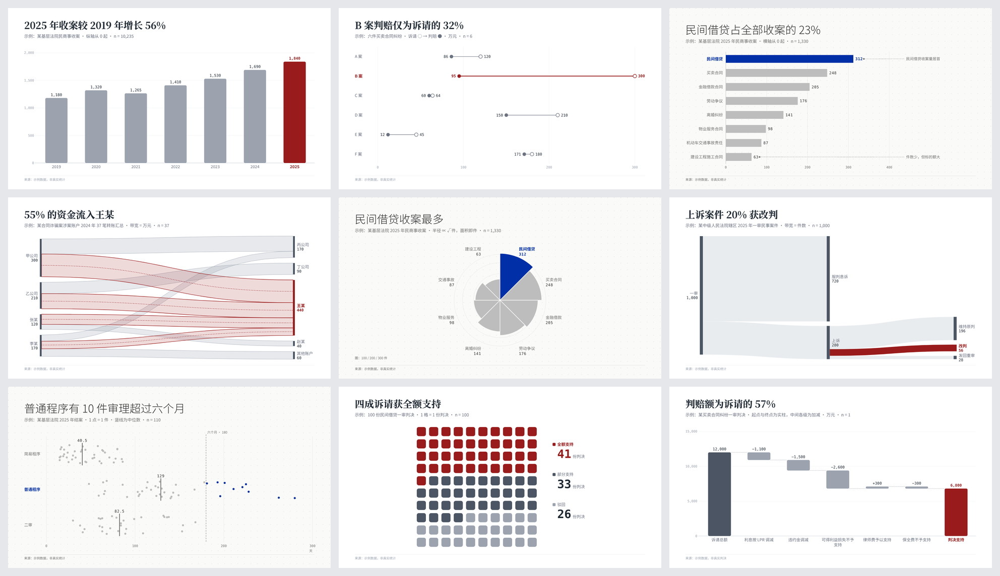

# 法律图表大师 · V6

把法律数据画成精炼的统计图，放进课件、讲座、文章与汇报。

**V1 到 V5 画事实与关系，这一件只画数字。**

| 图种 | 回答什么 | 例子 |
| --- | --- | --- |
| 竖柱 | 几个类目谁多谁少 | 历年收案量 |
| 横条 | 排名，类目名长 | 案由分布 |
| 百点方阵 | 构成，1 点 = 1 件 | 支持 / 部分支持 / 驳回 |
| 南丁格尔玫瑰 | 构成，讲课的展示页 | 案由构成 |
| 哑铃 | 同一件事的两个值 | 诉请与判赔 |
| 逐件分布 | 一件一个值，看离群 | 审理天数与审限 |
| 桑基 | 多段去向 | 一审 → 上诉 → 改判 |
| 汇入图 | 几个来源汇入几个去处 | 资金流向：付款账户 → 收款账户 |
| 逐级加减 | 从一个数一级级加减到另一个数 | 诉请怎样变成判赔；样本怎样筛到 n |

<p align="center"></p>
<p align="center"><sub>九种图。横条、南丁格尔玫瑰、逐件分布为歸藏风，其余为奇川风。数据均为示例。</sub></p>

## 三条与众不同的地方

- **图上的数只许算、不许编。** 标题里写「增长 56%」，脚本会从数据里算一遍；算不出来就不出图。
- **没有 n、口径、来源的图不出。** 公开裁判文书不是全量，统计图不写口径就是误导。
- **几何由守卫回读核对。** 柱长、点位、带宽、玫瑰的面积，都从成品里量回来，与数值不成比例就拦下。

## 怎么开口

> 用法律图表大师，把【材料】做成【这页要说明什么】，在【场合】给【谁】看，重点标【哪一处】。

- 「把这 286 份判决做成类案研究套图，律所内训讲，重点标『名为买卖、实为借贷』。」
- 「把这份判决书里的金额是怎么算出来的画成一页，给当事人看。」
- 「这五年收案量是……，做一页给合伙人会。」

**一批判决走类案编码**（`scripts/cases.py`）：案号、法院、层级、省份、年份由脚本从原文抽；
模型逐份编码，类别取封闭表、每个值附原文引句；校验逐份对账，一份不能少。
出一张 Excel 编码母表和一组图（样本筛选、构成、地域、层级、年份、金额分布）。

**一张逐件登记表走数据集 + 视图**（0.9.8）：一件一行照录进 `dataset`，`view` 里写按哪一列分组，
件数、金额合计、排序、合并长尾都由脚本算，模型不用自己数。出图时另写一份 `.trace.json`：
图上每一个数来自哪几件、编号是什么，律师可以逐个翻回原件。示例见 `examples/dataset-causes.json`。

## 用法

```bash
python3 scripts/make.py examples/waffle-outcomes.json -o out/判决结果
python3 scripts/make.py examples/rose-causes.json --style 歸藏风 --canvas a4-landscape
```

交付 SVG 与可编辑 PPTX；两种风格（奇川风 / 歸藏风），颜色只用风格原色。奇川风的填充形状都是贝塞尔小圆角
（PPTX 里的柱是原生圆角矩形，拖控点还能调），歸藏风一律直角。
细节见 [SKILL.md](SKILL.md)、[图种目录](references/catalog.md)、[硬规则](references/rules.md)。

## 致谢

汇入图的半透明交叉流带学自一类二部流带图（「四源汇入五宿」）。选图方法、面积开方、卡片四件套与「1 点 = 1 件」的单位分解，学自
[lieflat-charts](https://github.com/larashero3-dotcom/lieflat-charts)。本模块没有使用它的代码或模板，
理由见 [ADR 0001](docs/adr/0001-learn-not-copy.md)。
